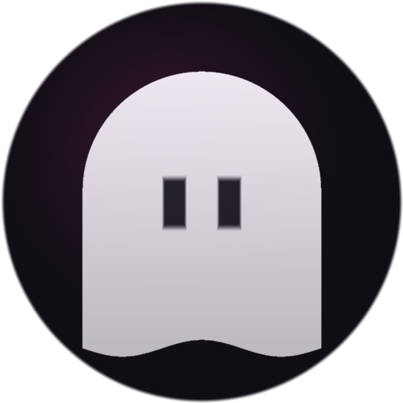
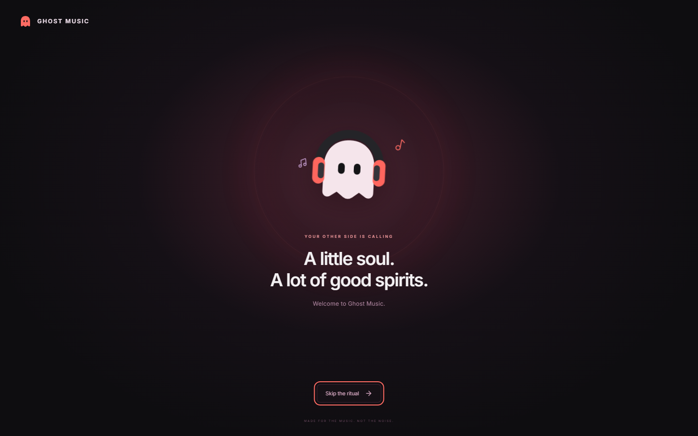
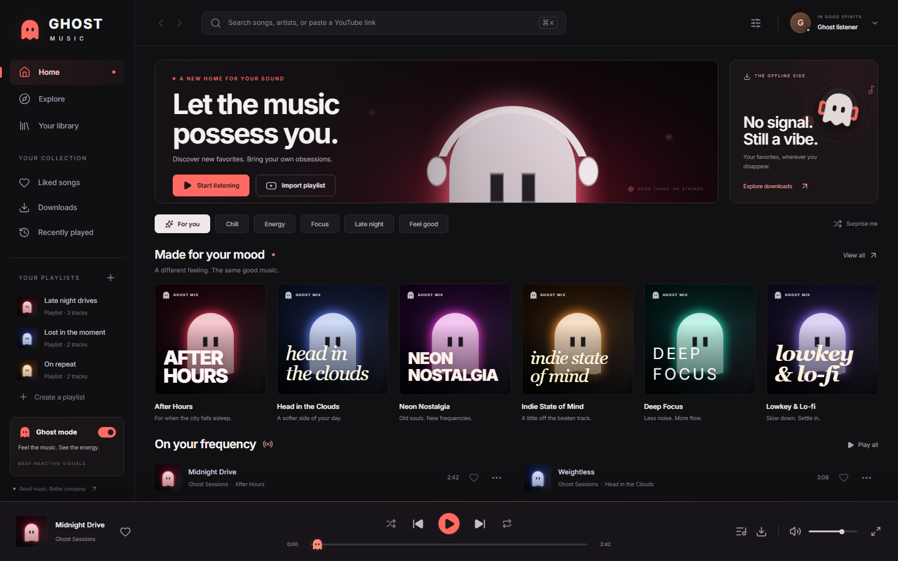
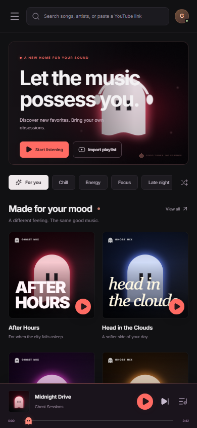
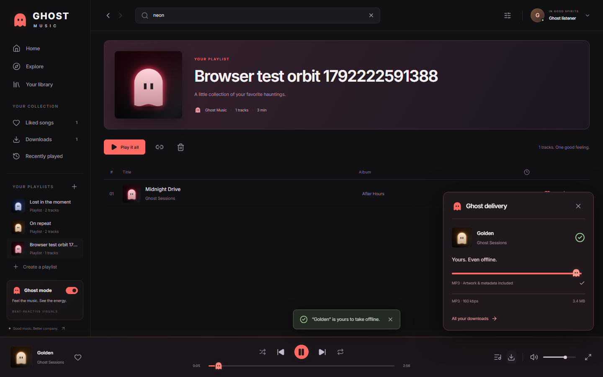

<div align="center">



# Ghost Music

**Your music. Your other side.**

A full-stack music app with a custom ghost identity, an animated startup ritual,
original instrumentals, YouTube import and search, real MP3 extraction, offline
playback, and audio-reactive visuals — shipped as a **Windows desktop app**, an
**Android app**, and a **web app** from a single codebase.

[](LICENSE)

</div>

---

## Download

| Build | File | Size | Notes |
| --- | --- | --- | --- |
| **Windows** (installer) | [GhostMusic-1.0.0-x64.exe](https://github.com/Grassybarks81808/Ghost-Music/releases/latest/download/GhostMusic-1.0.0-x64.exe) | ≈169 MB | Per-user install, desktop + Start-menu shortcuts, uninstaller. No admin rights. |
| **Windows** (portable) | [GhostMusic-1.0.0-portable.exe](https://github.com/Grassybarks81808/Ghost-Music/releases/latest/download/GhostMusic-1.0.0-portable.exe) | ≈169 MB | Single file, no install. First launch unpacks to a temp folder. |
| **Android** | [GhostMusic-1.0.0.apk](https://github.com/Grassybarks81808/Ghost-Music/releases/latest/download/GhostMusic-1.0.0.apk) | 35 KB | Android 8.0+ (minSdk 26, targetSdk 34). Needs a reachable Ghost Music server. |

Every release also publishes `SHA256SUMS.txt` so you can check what you download.

**Before you run the Windows build:** it is not code-signed, so SmartScreen shows
*"Windows protected your PC"*. Choose **More info → Run anyway**. See
[Troubleshooting](docs/TROUBLESHOOTING.md).

## Screenshots

| Startup ritual | Explore |
| --- | --- |
|  |  |

| Phone layout | A finished download |
| --- | --- |
|  |  |

## What it does

- **Real playback, not a mock.** Play/pause, previous/next, waveform-accurate seeking,
  shuffle, three repeat modes, volume, and a persistent queue.
- **Audio-reactive interface.** The Web Audio analyser drives the ghost UI from the
  actual frequency data of what is playing. There is no simulated beat detection.
- **Downloads that work.** yt-dlp resolves the source stream and FFmpeg writes a
  tagged MP3 (title, artist, album, embedded artwork) with live byte-accurate
  progress, then the file lands on your device.
- **Offline library.** Downloaded tracks are cached in the browser's Cache Storage
  and served with HTTP range support, so seeking keeps working with no network at all.
- **YouTube import and search.** Paste a public video or playlist link (up to 30 tracks)
  or search from the header. Private, deleted, and region-blocked sources report a real
  error rather than inventing results.
- **A library that is yours.** Likes, listening history, playlists, and share links.
- **Eight original instrumentals** seeded on first run — the Ghost Sessions, generated
  in-repo by [scripts/generate-audio.mjs](scripts/generate-audio.mjs). No API key needed.
- **Responsive and accessible.** Mobile-first layout, keyboard shortcuts
  (`Ctrl/Cmd + K` search, `Space` play/pause, `←`/`→` seek five seconds), focus-trapped
  dialogs, and reduced-motion support that skips the startup animation.
- **Installable PWA.** Add it to your home screen for a standalone app window.

## Quick start

Requirements: **Node.js 22+** and npm. Python 3.11+ is only needed for a
self-hosted extraction setup; the packaged builds bundle everything.

```bash
git clone https://github.com/Grassybarks81808/Ghost-Music.git
cd Ghost-Music
npm install        # also fetches yt-dlp and the platform FFmpeg binary
npm run assets     # generates the cover art, icons, and the eight MP3s
npm run dev        # http://localhost:3000
```

No database to provision: with no `DATABASE_URL` the app opens an **embedded
PostgreSQL** database (PGlite, PostgreSQL compiled to WebAssembly) inside
`.ghost-library/`, using the same Drizzle schema and queries as a server install.

### Production server

```bash
cp .env.example .env   # optional: set DATABASE_URL for PostgreSQL
npx drizzle-kit push   # create the schema (PostgreSQL only)
npm run build
npm start
```

With `DATABASE_URL` set, the app uses PostgreSQL through `pg` exactly as before;
without it, the embedded library is used. Extraction is CPU-bound and spawns
`ffmpeg`, so run it on a long-lived Node.js process with a persistent disk — not on
an edge or short-lived serverless runtime. Keep `GHOST_DATA_DIR` (or the working
directory) on durable storage: it holds `.ghost-downloads` and the embedded library.

### Health check

```bash
curl http://127.0.0.1:3000/api/health
# {"ok":true,"database":"embedded"}   or   {"ok":true,"database":"postgres"}
```

## The Windows app

`npm run dist:desktop` produces both Windows artifacts in `dist/`.

The app is not a wrapped website. `desktop/main.js` starts the bundled Next.js
standalone server as a child process on a free loopback port, waits for
`/api/health`, then loads that origin in a sandboxed window — so service workers,
range requests, native downloads, and the Web Audio analyser behave exactly as they
do on the web, with no server installed on the machine.

Nothing is fetched at first run: the server, FFmpeg, yt-dlp, the artwork, and the
eight MP3s are all inside the installer. Its data lives in
`%APPDATA%/Ghost Music` (`data/`, `logs/server.log`, and its own browser profile).

**Connect a phone on this network** in the app menu rebinds the server to
`0.0.0.0:43110` and shows the address to enter on your phone. The desktop app is
the server your Android app talks to. There is no authentication on that address,
so only use it on a network you trust; it returns to loopback-only on the next launch.

## The Android app

`bash scripts/install-android-toolchain.sh` once (JDK 21, Android SDK 35, Gradle
8.9 into `~/tools`), then `npm run build:android` → `dist/GhostMusic-1.0.0.apk`.

It is a thin native shell around the same web app. On first launch it asks for your
server address (`192.168.1.20:43110` from the desktop app, or a hosted deployment),
verifies it against `/api/health`, and remembers it.

- WebView with DOM storage, cookies, and service workers enabled, so downloads keep
  playing offline inside the app.
- Playback starts from the app's own buttons
  (`mediaPlaybackRequiresUserGesture=false`).
- A `GhostMusic.saveFile` JavaScript bridge: a WebView cannot follow a `blob:`
  download, so [src/lib/device.ts](src/lib/device.ts) streams the finished MP3 to
  native code in 384 KB chunks, which writes it to `Music/Ghost Music` through
  MediaStore.
- Plain `http://` is allowed for local-network servers; any other address opens in
  the system browser.

## How it works

Short version: Next.js App Router on the server, PostgreSQL-or-embedded for data,
yt-dlp + FFmpeg for extraction, and two thin native shells that both reuse the web
client. [docs/ARCHITECTURE.md](docs/ARCHITECTURE.md) covers the data model, the
download pipeline, the offline cache, and the packaged runtime in detail.

```
src/app/                 routes: pages plus the JSON API under src/app/api/
src/components/          the client app: shell, player bar, intro, modals
src/hooks/use-player.ts  playback, queue, and analyser state
src/db/                  Drizzle schema, connection, embedded schema
src/lib/                 server helpers, downloads, yt-dlp, paths, native bridge
desktop/                 Electron shell (main process, splash, builder config)
android/                 Android shell (MainActivity, manifest, Gradle)
scripts/                 asset generation, desktop staging, Android build, verification
docs/                    architecture, troubleshooting, screenshots
```

## Verification

| Check | Command |
| --- | --- |
| Types | `npx next typegen && npx tsc --noEmit` |
| Production build | `npm run build` |
| Browser suite (Playwright) | `node scripts/smoke-test.mjs` |
| Packaged desktop app (CDP) | `node scripts/verify-desktop.mjs` |
| Android save bridge | `node scripts/verify-android-bridge.mjs` |

The browser suite covers startup timing, desktop and mobile overflow, playback,
seeking, real analyser output, likes, search, playlists, public sharing, MP3
downloads and ID3 tags, ownership checks, byte ranges, persistence, and fully
offline playback. [BUILDING.md](BUILDING.md) lists exactly what was verified for
1.0.0 and what could not be verified on this machine.

## Troubleshooting

Common problems — SmartScreen, a phone that cannot reach the PC, stale yt-dlp,
missing FFmpeg, a blocked port, a locked database — are covered in
[docs/TROUBLESHOOTING.md](docs/TROUBLESHOOTING.md).

## Legal

Ghost Music is for music you own or are authorised to save. Extraction respects
source terms and requires an explicit permission confirmation in the app; keep it
that way. The bundled Ghost Sessions instrumentals and all artwork are original
works generated by this repository and are free to play, share, and download.

## License

[MIT](LICENSE) © 2026 Ghost Music contributors.
