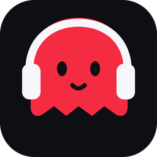

<div align="center">
  
  <h1>👻 Ghost Music</h1>
  <p><b>A YouTube&nbsp;Music–style desktop player for Windows.</b><br>
  Search, stream, queue, like and download music with a dark, red-accented UI — no browser required.</p>
</div>

---

## Download the Windows app

1. Open the [Releases page](../../releases) and grab **`Ghost-Music-Windows.zip`** (or the raw
   `Ghost-Music.exe` if you already have `yt-dlp.exe`).
2. Unzip it anywhere (keep the folder together — `yt-dlp.exe` ships next to the app).
3. Double-click **`Ghost-Music.exe`**. That's it.

> **Windows SmartScreen**: the build is not code-signed, so the first launch may show
> *"Windows protected your PC"* - click **More info → Run anyway**.
>
> `ffmpeg.exe` is optional but recommended: it enables MP3 conversion and HLS-only
> tracks. Drop it next to `Ghost-Music.exe` ([build here](https://www.gyan.dev/ffmpeg/builds/)).

The app also checks `PATH`, so an existing `yt-dlp`/`ffmpeg` install works too.

## What it does

| | |
|---|---|
| 🔎 **Search** | YouTube search through `yt-dlp`, shown as a native list with artwork, artist, duration and views. |
| ▶️ **Stream** | Plays straight from YouTube — nothing is written to disk while you listen. `mp3`, `m4a`, `opus/webm`, `flac` and `wav` are decoded in-process. |
| 📃 **Queue** | YouTube-Music style queue: play next, add to queue, reorder, shuffle, repeat off/all/one, and "keep playing related tracks" when a mix ends. |
| ♥ **Library** | Likes, playlists and the queue persist in `%APPDATA%\Ghost Music\library.json`. |
| ⤓ **Downloads** | MP3 (audio) or MP4 (video) into `Downloads\Ghost Music`, with a live progress bar and the raw `yt-dlp` log. |
| 🖥️ **Local API + web remote** | While the app runs it serves a small HTTP API on `127.0.0.1` *and* a remote-control web page — control the player from your phone's browser or from scripts. |
| 💻 **Native & fast** | Rust + `egui`, one ~10 MB executable, starts instantly, no Electron, no browser engine. |

### Keyboard shortcuts

| Keys | Action |
|---|---|
| `Space` | play / pause |
| `←` `→` | seek 5 s |
| `↑` `↓` | volume |
| `N` / `P` | next / previous |
| `Ctrl+K` or `/` | focus the search box |

## The local API (Ghost Music Connect)

The API listens on an ephemeral **loopback-only** port (shown in *Settings* and as
`API :port` in the title bar). Open the base URL in any browser for a phone-friendly
remote control page.

```bash
curl http://127.0.0.1:PORT/health
curl "http://127.0.0.1:PORT/search?q=lofi+beats&limit=10"
curl -X POST http://127.0.0.1:PORT/player/play -d '{"q":"lofi beats"}'      # search & play
curl -X POST http://127.0.0.1:PORT/player/play -d '{"id":"dQw4w9WgXcQ"}'    # play a video id
curl -X POST http://127.0.0.1:PORT/player/queue -d '{"q":"daft punk","next":true}'  # queue only
curl -X POST http://127.0.0.1:PORT/player/pause
curl -X POST http://127.0.0.1:PORT/player/seek  -d '{"seconds":42}'
curl -X POST http://127.0.0.1:PORT/player/volume -d '{"volume":0.6}'
curl -X POST http://127.0.0.1:PORT/download -d '{"q":"lofi beats","mode":"audio"}'
curl http://127.0.0.1:PORT/downloads
curl http://127.0.0.1:PORT/player/state
# any <audio> tag works too:
# <audio src="http://127.0.0.1:PORT/stream/dQw4w9WgXcQ" controls></audio>
```

Run it without a window (for scripts/servers): `Ghost-Music.exe --api-only`.

## Building from source

```bash
# Windows (MSVC toolchain) - produces target/release/ghost-music.exe
cargo build --release

# run it
cargo run --release
```

Requirements: Rust ≥ 1.76. `yt-dlp.exe` (required) and `ffmpeg.exe` (recommended) next
to the executable, in `./bin`, or on `PATH`.

Extras:

```bash
cargo test                                  # unit tests (progress parsing, covers, seek maths)
cargo run --release -- --selftest           # headless checks: tools, API, store
cargo run --release -- --api-only           # just the local API, no window
python tools/make_icon.py                   # regenerate assets/ghost.ico from the SVG art
```

## How it works

```
src/
  main.rs      CLI, window/icon setup, headless self test
  app.rs       application state, yt-dlp job plumbing, playback control, window chrome
  views.rs     Home / Explore / Library / Downloads / Settings screens
  widgets.rs   track rows, cards, chips, vector transport glyphs
  ghost.rs     the ghost mascot (splash animation, badges, seek handle)
  engine.rs    yt-dlp workers (search, stream resolution, downloads) + shared state
  player.rs    HTTP range reader + rodio/symphonia playback
  http_api.rs  local HTTP API + web remote page
  thumbs.rs    artwork download/decode/cache + procedural covers
  store.rs     JSON persistence (%APPDATA%)
  theme.rs     palette and egui theme
```

* Audio never touches the disk while streaming: the API server pipes the upstream
  stream to the player, and `player.rs` re-requests with `Range:` headers when you seek.
* HLS-only sources are remuxed once into the cache folder with ffmpeg.
* Releasing: push a tag like `v0.2.0` - GitHub Actions builds `Ghost-Music.exe`,
  bundles `yt-dlp.exe`, zips everything and attaches it to the release.

## Licence & legal

MIT — see [LICENSE](LICENSE). Ghost Music is a personal media player front-end for
`yt-dlp`; it is not affiliated with, endorsed by or sponsored by YouTube/Google.
Only download or stream content you have the rights to use.
